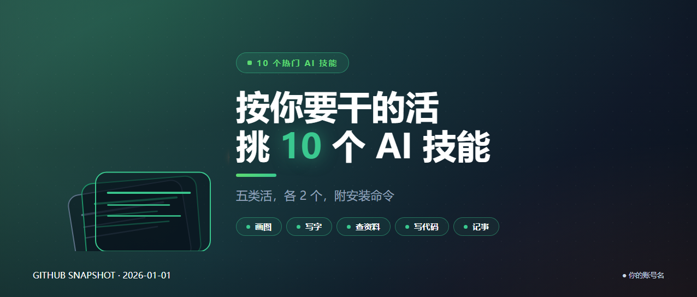

# 技能雷达 · wechat-skill-radar

把**近期热门的 AI 项目、Agent Skill、模型与科技热点**写成一篇能直接粘进公众号编辑器的文章——
多源找选题、用公开信息把事实核准（不需要本机实测）、按项目手册 / 科普解读 / 清单合集 / 选型指南四种框架成稿、
讲人话让外行读得懂、每篇都给读者一个能立刻用上的东西、给一组标题候选、
用可商用素材照片或黑底主体排版出图、交付前过一遍版权与违规词。

排版与手感对标过真实账号：`references/benchmark-guangguang-github.md` 是对公众号「逛逛GitHub」的实测拆解
（20 篇正文 + 20 张封面，逐项量过），正文行高、章节编号、封面方案 B 都来自这份测量；
`scripts/style_probe.py` 可以对任意账号复现同款测量。

这是一个 [Codex Skill](https://docs.openai.com/)：把 `SKILL.md` 和配套脚本放进 skills 目录，
之后直接说"看看最近有什么热门的 AI 技能，写成公众号文章"就能触发；也可以只把 `scripts/` 当普通工具链用。

## 它长什么样

封面按尺寸出两版（2.35:1 与 1:1，方图单独排版）：




正文配图用同一个色板和页脚，但每张换一种骨架（看板 / 对照 / 管线 / 阶梯 / 漏斗 / 矩阵）：


上面三张都是 `python scripts/design_kit.py demo` 生成的演示图，不是真实文章。
封面有两种方案，**一期只用一种**：

- **方案 A 大字报串联**：可商用照片做底 + 大字逐字串联 + 阶梯错位 + 左侧动线，
  色板从照片里取（`design_kit.poster_cover_page` / `use_palette_from_photo`）。
- **方案 B 黑底主体 + 右侧粗白字**：纯黑底 + 左 40% 立体主体 + 右 60% 超粗白字，
  **末行放进彩色实心块**（`design_kit.block_cover_page`）。对比最强，清单与盘点类首选。

方案 B 的做法取自对标账号「逛逛GitHub」的封面公式（20 张实测），完整拆解见
`references/benchmark-guangguang-github.md`。

## 四种文章框架

围绕**实用、知识普及、项目手册、指南**这四件事，每期选一种写：

| 框架 | 篇内数量 | 读者拿到什么 | 必答项 |
| --- | --- | --- | --- |
| 项目手册 | 1 个主角 + 1–2 个对照 | 一套能照着跑起来的步骤 | 它是什么 / 解决什么 / 怎么装怎么用 / 已知限制与坑（带来源）/ 适合谁 |
| 科普解读 | 1 个主题（可举 4–8 个项目） | 看懂这件事，以及跟自己的关系 | 一个类比、一处限制或争议、一句"跟我有什么关系" |
| 清单合集 | 8–10 个 | 先装哪个、怎么装、装完干什么 | 每个项目一条命令 + 一句"什么人不用装" |
| 选型指南 | 3–6 个同类 | 一张表 + 三种场景的结论 | 一张对比表、三种场景、每个候选"什么时候别选它" |

选题口径见 `references/topic-selection.md`，来源清单见 `references/sources.md`。

## 一篇文章是怎么产出的

```
定框架 ─► 多源雷达 ─► 抓 README/文档 ─► 建资料卡（内容+来源+日期） ─► 起一组标题 ─► 按框架成稿 ─► 出图 ─► 转 HTML ─► 自检
选题口径  trend_radar  crawler          素材/资料与出处.md              titles.md       发布稿.md       stock_photos  md2wechat  qa
          GitHub/HN/  pick_skills       ≥3 处硬证据                                     讲人话+能落地    + design_kit
          Reddit/X                                                                                      + render
```

工具：

| 脚本 | 干什么 |
| --- | --- |
| `scripts/trend_radar.py` | 多源热点雷达：GitHub 新项目 + Hacker News + Reddit（RSS），`link` 子命令记录 X 与网页线索 |
| `scripts/github_skill_crawler.py` | 按关键词集抓 GitHub 仓库（`--set skill/ai/general/marketing/finance/trade`），`--allow-projects` 收更广的 AI 项目；README 走 raw 地址，不占 API 配额 |
| `scripts/fetch_missing.py` | 被 GitHub 限流（HTTP 403）时按间隔只补没抓到的分类，再合并成候选清单 |
| `scripts/pick_skills.py` | 按方向筛候选、剔除已收录仓库、按热度排序；`--any` 不限方向 |
| `scripts/stock_photos.py` | 找可商用照片：`--theme tech/ai/cyberpunk/code/robot/data/abstract` 题材预设、多来源自动兜底、下载并写授权记录、标出疑似 AI 生成素材 |
| `scripts/design_kit.py` | 出图基础件与配色工具：从照片取色 `palette_from_photo`、对比度体检 `contrast_report`、大字报封面 `poster_cover_page`、**黑底主体封面 `block_cover_page`**、照片底图、配图画框、色板与图形件 |
| `scripts/render.py` | 本机 Chrome / Edge 无头渲染 HTML → PNG 或 JPEG（照片页面必须出 JPEG） |
| `scripts/md2wechat.py` | Markdown → 公众号可粘贴的内联样式 HTML（支持 `## 01 标题` 的编号式章节与行内命令，版式规格见 `references/wechat-layout.md`） |
| `scripts/qa.py` | 发布前自检：图片比例与体积、**图文比**、段落长度与**中位字数**、颜色白名单、必备模块、**章节编号是否渲染且连续**、禁用词、标题候选、AI 腔词表、标点频次、段落节奏、违规词与极限词、图片授权记录、**信息密度**、**有没有能照抄的东西**、**有没有没做过的第一人称实测** |
| `scripts/style_probe.py` | **对标账号版式探针**：给一个公众号文章链接，抓若干篇正文，测出它的排版数值、结构、配图与标题句式，产出 `_对标/<账号>/对标报告.md`。想学新账号时先跑它，别凭感觉说"它排版好看" |

## 快速开始

```bash
# 0. 依赖：Python 3.10+、本机装了 Chrome 或 Edge
#    （可选）pip install pillow  →  照片页面输出 JPEG、出图前压缩都用它
#    （可选）设 GITHUB_TOKEN 提速、设 PEXELS_API_KEY / UNSPLASH_ACCESS_KEY 换图库来源

# 1. 建一个当期项目，把脚本放进去（脚本按上一级目录当项目根，会自动创建素材/封面/配图）
mkdir -p ~/articles/2026-10-10_项目手册_MCP上手/_工作文件
cp -r scripts ~/articles/2026-10-10_项目手册_MCP上手/_工作文件/
cd ~/articles/2026-10-10_项目手册_MCP上手

# 2. 多源找选题
python _工作文件/trend_radar.py all --days 14 --top 20
python _工作文件/github_skill_crawler.py search --set ai --refresh --max-age-days 45
python _工作文件/github_skill_crawler.py search --set skill --allow-projects
python _工作文件/trend_radar.py link https://x.com/... --note "为什么值得写"

# 3. 筛候选 → 抓 README（官方文档、issue 区一起看）→ 把每条事实写进 素材/资料与出处.md
python _工作文件/pick_skills.py --list-industries
python _工作文件/pick_skills.py --any --top 20
python _工作文件/github_skill_crawler.py readme --only owner/repo owner/repo2

# 4. 起标题（references/titles.md）→ 按框架写稿（references/editorial-rules.md +
#    references/writing-craft.md + references/readability.md）→ 格式照 examples/

# 5. 出图：先定封面方案（A 照片底大字报 / B 黑底主体+右侧粗白字，一期只用一种）
python _工作文件/stock_photos.py search --theme cyberpunk --top 8 --min-width 1200
python _工作文件/stock_photos.py pick 3 --used-in 封面
python _工作文件/design_kit.py demo          # 先看基础件效果
python _工作文件/render.py _工作文件/pages/cover-2x1.html 封面/封面_1276x544.jpg --width 1276 --height 544
python _工作文件/render.py _工作文件/pages/fig1.html 配图/配图1_xxx.jpg --width 1080 --height 608

# 5b.（可选）想学一个新账号的排版：先量，别凭感觉
python _工作文件/style_probe.py seed "https://mp.weixin.qq.com/s/xxxxxxxx"
python _工作文件/style_probe.py index --name 账号名 --biz xxx --album xxx --max 20
python _工作文件/style_probe.py fetch --name 账号名 --max 20
python _工作文件/style_probe.py report --name 账号名     # → _对标/账号名/对标报告.md

# 6. 转公众号 HTML + 自检
python _工作文件/md2wechat.py 发布稿.md 公众号粘贴版.html
python _工作文件/qa.py 发布稿.md 公众号粘贴版.html      # 必须 0 FAIL
```

抓取没有配置 GitHub token 时，搜索配额是 10 次/分钟，脚本已做节流与缓存；一次跑完十几个分类通常会有一片 403，
直接跑 `fetch_missing.py` 补齐即可。Reddit 对服务器 IP 限流很紧（RSS 也会 429），脚本会重试并把抓到的子版进缓存，
隔几分钟重跑同一条命令或分成几个 `--subs` 小批就能补齐。

## 几条刻意的设计取舍

- **以真实信息为准，不要求本机实测。** 所有事实来自公开可核验的来源（官方页面、README、官方文档、issue 与讨论区、榜单），
  照抄并注明日期与出处，查不到的就不写。**不伪造实测**：没跑过就不写"我装了""我跑了一遍"；
  确实跑过的可以写，但要在元信息里标"自测"并把记录放进 `素材/资料与出处.md`（`qa.py` 会查这一条）。
- **三档来源分开写。** 官方口径、社区反馈、我的判断，三者不许混着写；星标、排名、价格都标快照日期。
- **每篇都要能落地。** 至少给一个读者能立刻用上的东西——一条可照抄的命令、一个最小示例、一张对照表或一条决策规则，
  并写清前置条件、预期结果、卡住时的下一步（`qa.py` 会查"通篇有没有能照抄的东西"）。
- **讲人话。** 术语第一次出现就解释，小标题写成结论或读者的问题，数字给参照系，每节第一句先给结论；
  劝退清单见 `references/readability.md`。同时保留"去 AI 腔"的硬约束（禁用词、句式黑名单、标点频次、段落节奏）。
- **不限定行业，限定框架。** 一期只讲一件事：一个项目、一个技术方向、一类人的需求，或一个事件；
  读者扫一眼标题和封面就知道这篇讲什么、给谁看。
- **四种框架，各有必答项。** 手册不写限制就不算手册，指南不给"什么时候别选它"读者就没法决定。
- **合规前置。** 只用四类素材（官方材料、公开页面事实、短引用、可商用素材）；违规词、极限词、隐私、
  AI 生成标识按 `references/compliance.md` 执行，`qa.py` 会拦违规词并检查图片授权记录。
- **配图与封面以可商用素材为底。** 素材照片做底 + 代码压字（封面、章节图、氛围图）；官方 README / 文档 / 发布页的图
  做证据类插图（注明来源、可加红框、保留水印）；对照表与流程用代码画。**题材限定科技 / AI / 赛博朋克这条线**，
  不用办公室绿植、咖啡杯这类通用商务图。照片页面一律输出 JPEG（体积从 700KB 降到 ≈100KB）。
- **封面二选一，一期只用一种。** 方案 A 大字报串联（照片底，每行 4–7 字、字间圆点串联、阶梯错位、
  左侧动线、最多点亮两处；2.35:1 排两行长句，1:1 排三行短句）；方案 B 黑底主体 + 右侧粗白字
  （纯黑底、左 40% 立体主体、右 60% 超粗白字、末行放进彩色实心块、整张只有一个彩色）。
  清单与盘点类用 B（列表页里最跳），科普与选型类用 A（要氛围）。
- **配色有逻辑，不靠感觉。** 从素材照片取色（底色同源、主色取自画面饱和色、点缀取第二色相）→ 明度校准到
  可读区间（大字 ≥3:1、小字 ≥4.5:1）→ `contrast_report()` 体检两端底色；一期共用一个色板，色相不超过两个。
- **版式固定，内容换新。** 排版规格（15px 正文 / **行高 2em** / 字距 0.034em / 左右 8px 缩进、
  章节用 `## 01 标题` 渲染成大号墨绿编号、命令用反引号标成等宽小块、单一强调色、导语灰卡、13px 图注、
  不声明 font-family）固定；每期换的是结构、叙事、封面构图和配图骨架。
  行高 2em 与编号件取自对标账号的实测规格，见 `references/benchmark-guangguang-github.md`。
- **段落压短、图文比拉高。** 对标账号的段落中位数是 34 字（97.6% 的段落 ≤80 字），图文比 6.2 张/千字
  （每 2–3 段一张图）——这是长文能读下去的真正原因。我们的门槛是段落中位 ≤80 字、图文比 ≥2 张/千字，
  `qa.py` 两项都会查。
- **学对标学做法，不学它的词。** 可以借结构、排版、图文比、标题两截式（硬事实 + 人味，句号收尾）；
  **不借**夸张词（堪称一绝、玩疯了、狠狠收藏）、结尾关注引导与名片、无署名的截图、"我实测"式自证。
- **每期给一组标题，而不是一个。** 6–8 条候选（1 条推荐 + 3–5 条备选），覆盖官方数据、门槛提示、场景痛点、
  对比选择等钩子，推荐标题 ≤20 字，写进发布稿元信息，交付时连理由一起报给用户挑。
- **色板可换，风格不换。** 封面与配图每期可以换一套基调（`references/visual-recipes.md` 备了五套），
  但账号锚点固定：封面右下角的账号小字、深底亮主色的明暗关系、封面的五件套信息骨架。
- **自检分两层。** 机器能查的交给 `qa.py`（必须 0 FAIL），机器查不了的（易懂程度、能不能落地、授权是否署名）
  走 `references/qa-checklist.md` 的目视清单。

## 仓库结构

```
SKILL.md                      技能入口（什么时候用、硬性规则、工作流）
references/
  topic-selection.md          选题：四种框架、主题口径、热度判断、入选与去重
  sources.md                  来源：GitHub / Hacker News / Reddit / X / 网页搜索怎么用
  editorial-rules.md          内容边界、四种框架的骨架与必答项、平行字段、数据与出处口径
  benchmark-guangguang-github.md  对标档案：公众号「逛逛GitHub」的实测拆解（20 篇正文 + 20 张封面），学什么不学什么
  writing-craft.md            写作手感：三档来源、证据链、落笔模板、落地四件套、AI 腔禁用词
  readability.md              简单易懂：术语怎么解释、数字给参照系、小标题怎么写、劝退清单
  compliance.md               版权与合规：许可证、短引用、平台红线、极限词、图片授权、AI 标识
  titles.md                   标题候选：钩子类型表、起标题流程、写进元信息的格式
  wechat-layout.md            公众号排版规格（15px / 行高 2em / 编号章节）、图片与署名、排版层面的去 AI 腔
  visual-recipes.md           素材从哪来（科技/AI/赛博朋克题材表）、封面两方案怎么选、选图标准、配色三步、体积预算、常见的坑
  qa-checklist.md             发布前自检清单（机器项 + 目视项 + 版权合规 + 交付汇报）
scripts/                      十个工具（含 style_probe 对标探针；trend_radar / stock_photos / render 支持 JPEG 等）
examples/
  make_pages_demo.py          出图模板：封面两种尺寸 + 照片底配图 + 代码信息图，改文案即可跑
  sample-project-manual.md    项目手册的稿件格式示例
  sample-selection-guide.md   选型指南的稿件格式示例
  sample-article.md           清单合集的稿件格式示例
docs/                         README 里的演示图
```

## 许可

MIT
